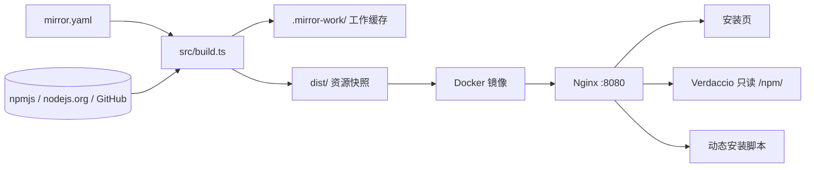
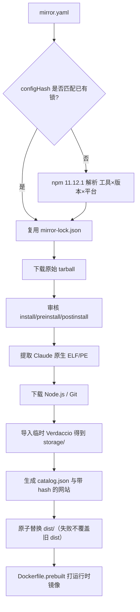

# Agent Mirror

将 Claude Code、Codex CLI、DeepSeek Harness 的**指定精确版本**及依赖打成一份只读快照，外网构建后 `docker save`，内网 `docker load` 即可提供：

- 中文安装页
- 无 uplink 的只读 npm registry
- Node.js / Git 下载
- Claude Code 内网原生安装器

Claude Code 走原生安装器；Codex 和 DSH 走页面给出的 `npm install`，从内网 registry 安装。没有 Node.js 的 Linux 用户可把镜像内的 Node.js 装到 `~/.local`。模型服务、账号、凭据和项目自身依赖**不在**本镜像范围内。

内网不会自动追最新版。每次加版本、改配置，都必须在外网重新构建缓存和 Docker 镜像再导入。

## 目录

- [架构](#架构)
- [维护流程](#维护流程)
- [GitHub 每月自动构建](#github-每月自动构建)
- [部署与运行](#部署与运行)
- [客户端安装](#客户端安装)
- [测试与支持范围](#测试与支持范围)
- [官方参考](#官方参考)

---

## 架构

三层分离：**配置 → 资源快照 `dist/` → 运行时镜像**。加版本只做到 `dist/`；用户能装到新版本，必须再打 Docker 并在内网替换容器。



### 构建流水线



`add-latest` 只做「查 npm `latest` → 写入 yaml → 调用上面这条流水线直到 `dist/`」。它**不会**执行 `docker build`。

### 运行时

容器内由 `runtime/start.mjs` 拉起三个进程（任一退出则整个容器退出，方便 `restart` 策略恢复）：

| 进程 | 地址 | 作用 |
| --- | --- | --- |
| Nginx | `:8080` | 对外入口：静态站、registry 反代、安装脚本反代 |
| Verdaccio | `127.0.0.1:4873` | 只读 registry，storage 来自镜像内 `/opt/mirror/storage`，**无 uplink** |
| 辅助 HTTP | `127.0.0.1:4874` | `/healthz` 以及按请求 Host 填入镜像地址的安装脚本 |

数据根目录默认 `/opt/mirror`（构建产物 `dist/`）。不挂资源卷，避免旧卷盖住新镜像。

请求路径：

| 入口 | 来源 |
| --- | --- |
| `/` | `dist/public/` 中文安装页（`index.html` 带 hash 的 `app.*.js` / `style.*.css`） |
| `/catalog.json` | 本镜像实际收录的版本、脚本白名单、校验 |
| `/npm/` | Verdaccio；只发布锁文件里的版本，不转发公网 metadata |
| `/claude-code-releases/<version>/` | 从平台 optional 包抽出的 `claude` / `claude.exe` |
| `/downloads/` | Node.js、Git 等 |
| `/install.sh`、`/install.ps1` | Claude 原生安装器，运行时替换镜像 origin |
| `/install-node.sh` | Linux x64 glibc 用户目录 Node.js |
| `/healthz` | Nginx + Verdaccio + 目录就绪 |

网页按所选工具版本生成精确的 `--allow-scripts` 清单，来自 `approvedScripts` 与该版本依赖闭包的交集。

### 仓库地图

| 路径 | 职责 |
| --- | --- |
| `mirror.yaml` | **唯一**人工维护的资源配置：工具版本、平台、Node、附加资源、已审核脚本指纹 |
| `mirror-lock.json` | 工具及传递依赖的精确闭包（integrity、上游 URL）。与 yaml 的 `configHash` 绑定 |
| `package-lock.json` | 构建器 / Verdaccio 等**本仓库**依赖，与镜像资源闭包无关 |
| `src/config.ts` | 读取并校验 yaml：只接受精确 semver |
| `src/resolve.ts` | 用项目自带 npm 11.12.1 解析各 root×平台；向 registry 拉 packument，不用 `--prefer-offline` |
| `src/artifacts.ts` | 下载 tarball、脚本审核、Claude 原生二进制检查 |
| `src/registry.ts` | 把原始 tarball 导入临时 Verdaccio，得到可随镜像走的 `storage/` |
| `src/site.ts` | 把 `web/` 拷进 `dist/public` 并给 JS/CSS 加内容 hash |
| `src/build.ts` | 编排 validate / resolve / build |
| `src/tool-versions.ts` | 查 `dist-tags.latest`、改 yaml、触发缓存构建 |
| `src/add-latest.ts` | Codex / DSH 追加 latest，**不删旧版本** |
| `src/remove-version.ts` | 显式删除旧版本 |
| `src/smoke.ts` | 断网安装与启动验收 |
| `src/record-validation.ts` | 把通过的 smoke 报告写入 catalog（不在用户首页展示） |
| `web/` | 安装页源码 |
| `installers/` | Claude / Node / 工具安装脚本模板 |
| `runtime/` | 容器入口与健康检查 |
| `Dockerfile` | 在镜像内完整跑 `build:mirror`（首次或无本地 `dist/`） |
| `Dockerfile.prebuilt` | 把已审阅的本地 `dist/` 打进运行时，日常发版用这个 |
| `.mirror-work/` | 本机工作缓存：npm cache、tarball、解包检查、`building` 锁 |
| `dist/` | 成功构建的快照；失败时仍保留上一份 |
| `releases/` | `docker save` 的 tar 与 SHA-256 |
| `docs/` | 脚本审查、客户端审查、Win7 实践 |
| `VALIDATION.md` | 实际跑过的验收与未覆盖边界 |

`configHash` 只覆盖 `registry`、`platforms`、`tools`、`npmPackages`、`node`。只改 `approvedScripts` 不会重新解析依赖，会复用锁并重新打包。

---

## 维护流程

构建机：能访问 npm、nodejs.org、GitHub、Docker/Debian 源；本机 Node.js **≥ 24**（与 `engines` 一致）；首次完整构建预留 **≥ 15 GB**。部署机：x86_64 Linux + Docker，不必装 Node/Nginx/npm。

### 必须记住的边界

1. **`npm run add-latest` ≠ 打 Docker 镜像。** 它最多把新版本写进 `mirror.yaml` 并生成 `dist/`。内网用户要看到新版本，还要 `docker build`、导出、load、换容器。
2. **只自动追 Codex 和 DSH 的 npm `dist-tags.latest`。** Claude、Node.js、Git、`npmPackages` 必须改 yaml。
3. **加版本永不删旧版本。** 删版本只能 `remove-version` 或手改 yaml。
4. **缓存构建失败会把本次 yaml 改动回滚**，避免留下尚未入库的版本。yaml 已改好、只差缓存时，跑 `build:mirror`，不要再跑 `add-latest`（没有更新的 latest 时它会跳过构建）。
5. **新的 install/preinstall/postinstall 会让构建停住。** 先审脚本再把 tarball SHA-256 写入 `approvedScripts`。

### 日常一条龙：追 Codex / DSH latest 并发布镜像

在外网构建机：

```bash
git pull   # 若用版本库
npm ci --ignore-scripts --no-audit --no-fund

# 1) 先看将要追加什么（不改文件）
npm run add-latest -- --dry-run

# 2) 写入 mirror.yaml 并构建 dist/
npm run add-latest

# 若输出 “No configuration change”，但 dist/catalog.json 还没有这些版本：
npm run build:mirror

# 3) 保存资源闭包，便于下次复现、也便于 Dockerfile 在镜像内构建
cp dist/mirror-lock.json mirror-lock.json

# 4) 打运行时镜像（使用刚刚的 dist/，不再从公网解析工具包）
TAG=$(date +%Y%m%d)    # 例：20260912
docker build -f Dockerfile.prebuilt -t "agent-mirror:$TAG" .

# 5) 导出，拒绝覆盖已有同名 tar
bash scripts/export.sh "agent-mirror:$TAG" "releases/agent-mirror-$TAG.tar"
```

把 `releases/agent-mirror-$TAG.tar` 和 `.sha256` 拷到内网后：

```bash
sha256sum -c "agent-mirror-$TAG.tar.sha256"
docker load -i "agent-mirror-$TAG.tar"

docker rm -f agent-mirror
docker run -d --name agent-mirror --restart unless-stopped \
  -p 8080:8080 \
  -e PUBLIC_URL=https://agents.example.internal \   # 若前面有反代；直连 IP 可省略
  "agent-mirror:$TAG"
```

保留旧镜像标签和原来的 `docker run` 参数，回滚时用旧标签再起一个容器。Compose：

```bash
MIRROR_TAG=20260912 MIRROR_PORT=8080 docker compose up -d
```

`compose.yaml` 设置了 `pull_policy: never`，必须先 `docker load`。

### GitHub 每月自动构建

仓库提供 [`.github/workflows/monthly-image.yml`](.github/workflows/monthly-image.yml)：

- **定时**：每月 1 日 00:00 UTC（北京时间 08:00）
- **手动**：Actions 里选 “Monthly image” → Run workflow
- **做什么**：`add-latest --config-only`（只追 Codex / DSH 的 npm `latest`）→ `build:mirror` → 提交变更后的 `mirror.yaml` / `mirror-lock.json` → `Dockerfile.prebuilt` 打镜像并推到 GHCR

`dist/`、`.mirror-work/`、镜像 tar **不进 git**。定时任务只在**默认分支**上的 workflow 文件生效；推送到 GitHub 并打开 Actions 之后才会跑。

首次把本仓库放到 GitHub：

```bash
# 在 GitHub 上新建空仓库（不要勾选自动加 README），然后：
git remote add origin git@github.com:<owner>/<repo>.git
git push -u origin main
```

推上去的镜像名为：

```text
ghcr.io/<owner>/<repo>:YYYYMMDD
ghcr.io/<owner>/<repo>:latest
```

仓库名会转成小写。有 GitHub 权限的机器可以拉下来再交给内网：

```bash
echo "$GITHUB_TOKEN" | docker login ghcr.io -u USER --password-stdin
docker pull ghcr.io/<owner>/<repo>:YYYYMMDD
docker tag ghcr.io/<owner>/<repo>:YYYYMMDD agent-mirror:YYYYMMDD
bash scripts/export.sh agent-mirror:YYYYMMDD releases/agent-mirror-YYYYMMDD.tar
```

注意：

- 新的生命周期脚本仍会让构建失败，workflow **不会**自动写入 `approvedScripts`。失败后按上面的脚本审核步骤改 yaml，再手动跑一次 workflow。
- 默认分支若开启保护规则，`github-actions[bot]` 可能推不回 yaml/lock；给该 bot 放行，或把仓库的 Actions 权限设为可写。
- 镜像约 1.6 GB。GitHub Free 的 Packages 存储可能不够，需提高额度或改成自托管 runner、只构建不推送。
- 标准 `ubuntu-latest` 磁盘紧张，workflow 会先删掉 Android/dotnet 等预装软件，构建完再丢掉 `.mirror-work`。

### 第 2 步失败时怎么处理

**`ETARGET` / `No matching version found`**

`add-latest` 读的是当前 registry packument；解析阶段也会重新拉 metadata。若仍 ETARGET：确认该版本确实在 [npm](https://www.npmjs.com/) 上，且 `dist-tags.latest` 对应的版本出现在 packument 的 `versions` 里。不要用过期的离线 packument 当真。

**`Review lifecycle scripts ... Unapproved: pkg@version`**

构建器**从不执行**第三方安装脚本，只根据 tarball 里的 `package.json` 收集 `preinstall` / `install` / `postinstall`（含隐式 `node-gyp rebuild`）。

1. 打开 `.mirror-work/script-audit.json`，看 `scripts`、`sha256`、`inspection` 目录。
2. 读解包后的脚本：是否访问公网、是否强制本机编译、是否改系统文件。参考 [docs/SCRIPT-REVIEW.md](docs/SCRIPT-REVIEW.md)。
3. 通过则把 `name@version: <tarball sha256>` 写入 `mirror.yaml` 的 `approvedScripts`。
4. **不要**再跑 `add-latest`（yaml 若已被回滚，先确认版本列表；若版本还在则直接构建）：

```bash
npm run build:mirror
```

不要批量批准所有未知脚本。需要编译器或额外下载的包（例如未收录的 DSH 对 `fs-ext` 的依赖）不应只靠“批准脚本”宣称可离线使用。

**`.mirror-work/building` 已存在**

并发保护。看文件里的 PID：还在跑就等；确认已死再删该文件。活跃构建期间不要删。

**`dist/` 没变**

失败不会替换现有 `dist/`。上一份成功快照仍在；`dist.previous/` 是成功替换前的备份。

### 只改配置、不查 latest

手工编辑 `mirror.yaml` 后：

```bash
npm run validate
npm run build:mirror
cp dist/mirror-lock.json mirror-lock.json
```

然后同样走上面的 `Dockerfile.prebuilt` → `export.sh` → 内网替换。

适用：加 Claude 版本、改 `defaultVersion`、加 `npmPackages`、改 Node / Git、加平台。

Claude 没有 `add-latest`。新版本必须写进 `tools.claude.versions`。若官方改为另一种平台包分发方式，`requiredClaudeNative` 会失败，需要改 `src/artifacts.ts`，不能假装缓存完整。

### 删除旧版本

```bash
npm run remove-version -- --dry-run dsh 0.1.2-alpha.5
npm run remove-version -- dsh 0.1.2-alpha.5
# 只改 yaml：
npm run remove-version -- --config-only codex 0.153.3
```

拒绝删掉某工具的最后一个版本。缓存构建失败同样回滚 yaml。删完后仍需 `cp dist/mirror-lock.json mirror-lock.json` 并重新打 Docker。

### 命令与产物对照

| 命令 | 改 yaml | 生成 `dist/` | 打 Docker 镜像 | 删旧版本 |
| --- | --- | --- | --- | --- |
| `npm run add-latest -- --dry-run` | 否 | 否 | 否 | 否 |
| `npm run add-latest -- --config-only` | 是 | 否 | 否 | 否 |
| `npm run add-latest` | 是 | 是（有变更时） | **否** | 否 |
| `npm run build:mirror` | 否 | 是 | **否** | 否 |
| `docker build -f Dockerfile.prebuilt …` | 否 | 否（要求已有 `dist/`） | 是 | 否 |
| `docker build -t … .`（默认 Dockerfile） | 否 | 在镜像内构建 | 是 | 否 |
| GitHub Actions `Monthly image` | 是（Codex/DSH latest） | 是（runner 上，不提交） | 是（推 GHCR） | 否 |
| `npm run remove-version -- …` | 是 | 是（有变更时） | **否** | 是 |

`add-latest` / `remove-version` 常用参数：`--tool codex|dsh`（可重复）、`--config FILE`、`--dry-run`、`--config-only`。环境变量 `MIRROR_CONFIG` 可改配置路径。

### 两种 Docker 构建

**推荐（日常发版）**：本机已有审阅过的 `dist/`：

```bash
docker build -f Dockerfile.prebuilt -t agent-mirror:$TAG .
```

`Dockerfile.prebuilt` 使用单独 dockerignore，把 `dist/` 拷到 `/opt/mirror`，不再解析工具包。

**从零（无本地 dist，或要在 Docker 内完整复现）**：

```bash
docker build --platform linux/amd64 -t agent-mirror:$TAG .
```

默认 `Dockerfile` 的 builder 阶段会 `npm run build:mirror`，并用 BuildKit cache 挂 `.mirror-work`。仓库里的 `mirror-lock.json` 必须与当前 `mirror.yaml` 的 `configHash` 一致，否则会在镜像内重新解析。

显式钉死某次资源闭包：

```bash
MIRROR_LOCK=/路径/旧发布/mirror-lock.json npm run build:mirror
```

锁与当前版本/平台配置不一致会直接失败，避免悄悄换依赖。网站和附加资源仍按当前 yaml 生成。资源闭包可复现，不等于 Docker 镜像字节相同（构建时间、Debian 安全更新会变）。

只想刷新传递依赖：先归档根目录和工作缓存里的旧 `mirror-lock.json`，再构建。

### `mirror.yaml` 字段

- `tools.*.versions`：精确版本数组，可含预览版；可同时保留多个版本。
- `tools.*.defaultVersion`：网站和内网 `latest` 标签；必须在数组中。`add-latest` 会把 Codex/DSH 的 default 改成新的 latest。
- `npmPackages`：额外精确 npm 包（如可选 npm 12），**不是**用户装工具的前置步骤。
- `platforms`：默认 `linux-x64`（glibc）和 `win32-x64`。Alpine/musl 必须另加 `node-musl` 资源并单独验收。
- `node.version`：精确 Node.js；构建时核对依赖 `engines`。
- `assets`：固定 URL + SHA-256，默认含 Git for Windows。
- `approvedScripts`：`name@version` → 该 tarball 的 SHA-256。

服务只发布清单中的版本，不向客户端宣告尚未下载的 `latest`。tarball 保持上游原始字节。

---

## 部署与运行

```bash
# 内网：校验并 load 已构建的 tar
sha256sum -c agent-mirror-20260912.tar.sha256
docker load -i agent-mirror-20260912.tar
docker run -d --name agent-mirror --restart unless-stopped \
  -p 8080:8080 agent-mirror:20260912
```

访问 `http://部署机IP:8080/`。无需在部署机安装 Node.js、Nginx 或 npm，无需初始化数据卷。

需要 HTTPS 时走公司反代，并信任公司 CA。反代必须挂在域名**根路径**：

```bash
docker run -d --name agent-mirror --restart unless-stopped \
  -p 8080:8080 -e PUBLIC_URL=https://agents.example.internal \
  agent-mirror:20260912
```

`PUBLIC_URL` 只接受 http(s) origin，不能带子路径、凭据或查询。未设置时，网页和安装脚本使用当前请求地址，改 IP 或映射端口不必重建镜像。

默认匿名只读 HTTP。入口禁止写入；Verdaccio 关闭注册、发布和删除。日志走标准输出；镜像自带 Docker HEALTHCHECK。

更新：先 load 新镜像，再删掉旧容器并用新标签启动。镜像内没有用户密钥、模型凭据或工作区。

---

## 客户端安装

网站只显示**当前镜像里真实存在的版本**。命令以页面为准。

Claude Code 不要求本机已有 Node.js：

```bash
curl -fsSL "http://部署机IP:8080/install.sh" | bash -s -- "2.1.266"
claude --version
```

Windows 用页面上的 `install.ps1`。脚本只访问当前镜像，按系统取二进制，对照 manifest 校验 SHA-256。安装位置：Linux/macOS 为 `~/.local/share/claude/versions/` + `~/.local/bin/claude`；Windows 为 `%USERPROFILE%\.local\share\claude\versions\` + `%USERPROFILE%\.local\bin\claude.exe`。

Codex、DSH 用页面上的 `npm install`，从 `/npm/` 安装所选版本。Linux 装到 `~/.local`（命令在 `~/.local/bin`）；Windows 装到 `%APPDATA%\npm`。DSH 需要 Node.js **22.19+（22.x）或 24+**。

Linux x64（glibc）的 Node 一键命令把镜像内 Node.js 装到 `~/.local/share/node/versions/`，并在 `~/.local/bin/` 链出 `node`、`npm`、`npx`、`corepack`。已有合适 Node 的用户可跳过。当前镜像提供 Node.js 24.15.0。

选其他已收录版本再执行页面命令即可升级或降级。内网环境应对 Claude Code 使用 `DISABLE_UPDATES=1`（用户或企业设置），升级仍从本镜像重装指定版本。

---

## 测试与支持范围

```bash
npm run check
npm test

# 无外网出口的 Docker internal 网络；服务端和客户端都在该网
bash scripts/test-offline.sh agent-mirror:20260912
```

断网脚本默认用镜像内 Node.js 和自带 npm 当客户端，不拉取任何镜像。第二个参数可换成本机已有的 Node 测试镜像。客户端使用全新 npm 缓存、配置、HOME 和隔离的全局 prefix 安装每个工具版本；确认 Claude 目标是真实 ELF/PE 且与原生资源 SHA-256 一致；跑版本/帮助命令；启动 dsh web 并检查本机页面；验证缺包 404 和写接口拒绝。结果写入 `reports/`。

DSH 还会加载 Koffi、用 sharp 出图、经 node-pty 起一个带标记的 shell。通过后把与**当前 `catalog.builtAt`** 匹配的报告写入 catalog 再重新打包；用户首页不展示这些内容：

```bash
node src/record-validation.ts reports/smoke-linux-x64.json
docker build -f Dockerfile.prebuilt -t agent-mirror:20260912 .
```

报告只证明其列出的操作系统，不代表所有 glibc 发行版都已通过。

Windows 在真实主机/虚拟机阻断公网后：

```powershell
$env:MIRROR_URL = 'http://部署机IP:8080'
$env:MIRROR_NETWORK_ISOLATED = '1'
npm run smoke
```

不要把 Linux 容器测试当成 Windows 或全发行版测试。自动测试不覆盖登录、模型调用或真实交互任务。

| 系统 | 策略 |
| --- | --- |
| Windows 11 x64 | 主要目标，需真机测试 |
| Windows 10 22H2 x64 | 分工具验收；Codex 尽力支持 |
| Windows 7 | 不支持 Agent 本机运行，见 [docs/WIN7-PRACTICE.md](docs/WIN7-PRACTICE.md) |
| Ubuntu 22.04/24.04、Debian 12/13、Rocky 9 | 主要 Linux 目标，逐环境测试 |
| Alpine/musl | 默认关闭，加资源后独立验证 |
| 其他 Linux | 按 libc、系统库、指令集判断，不标为已验证 |

最新执行结果只记在 [VALIDATION.md](VALIDATION.md)。公司系统源负责基础运行库和项目开发依赖；可用 `npmPackages` 扩充 Verdaccio，但本项目不是通用 npm/apt/dnf 全量镜像。

---

## 官方参考

- [Claude Code 安装](https://code.claude.com/docs/en/setup)
- [Claude Code 原生安装与版本管理](https://code.claude.com/docs/en/installation)
- [Codex CLI](https://learn.chatgpt.com/docs/codex/cli)
- [DeepSeek Harness](https://www.deepseek.com/harness/)
- [Verdaccio 配置](https://www.verdaccio.org/docs/configuration/)
